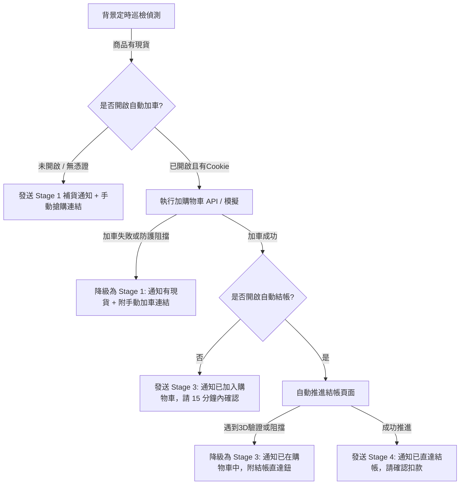

# 商品庫存監控與智慧提醒系統 (Inventory Notifier Agent)

支援電商（Costco 好市多、PChome 等）商品庫存即時偵測、背景自動巡檢、階梯式自動加車與結帳、桌面推播與 Telegram 雙向通報之智慧代理系統。

---

## 🚀 快速啟動指南 (Quick Start)

### 模式一：本地 Web 控制台與桌面推播（最推薦）
完全零雲端依賴，可直接在個人電腦（Mac / Windows / Linux）啟動全功能圖形化介面：

1. **安裝環境依賴**
   ```bash
   pip install fastapi uvicorn httpx beautifulsoup4 python-dotenv
   ```
2. **啟動 Web 控制台**
   ```bash
   python3 run_local_app.py
   ```
3. **瀏覽器開啟控制台**
   👉 **http://localhost:8000**
   * **新增商品**：貼上商品網址，系統自動檢驗並抓取商品名稱與即時現貨狀態。
   * **啟用桌面通知**：點擊頂部「啟用瀏覽器本機通知」，補貨時彈出桌面右下角推播卡片與聲音。
   * **搶購設定**：自由切換「自動加購物車 (Stage 1)」與「自動直達結帳確認 (Stage 2)」。
   * **巡檢頻率**：可調整背景掃描週期（1~10分鐘）與持續缺貨回報頻率（1~24小時或僅有貨時通知）。

---

### 模式二：純 Telegram Bot 常駐模式（可選）
若希望透過 Telegram 聊天機器人遠端操控：
```bash
python3 run_local_bot.py
```
* 支援底部 Reply Keyboard 常駐按鈕：`➕ 新增追蹤`、`📋 目前追蹤清單`、`⚙️ 巡檢設定`、`❌ 移除追蹤`。
* 點擊清單時自動**多工並行（AsyncIO Gather）**重新爬蟲所有商品的即時狀態。

---

## 🏗️ 系統架構與檔案清單 (Architecture & File Overview)

本專案採模組化與高容錯架構設計，各檔案分工清晰，便於日後維護與 AI 迭代改版：

```
inventory-notifier-agent/
│
├── run_local_app.py           # 【本地 Web 控制台進入點】
│                              # 包含 FastAPI 後端、SPA 單頁控制面板、背景定時巡檢迴圈、
│                              # Telegram 輪詢 Worker 與本機桌面推播佇列 (Polling Queue)。
│
├── run_local_bot.py           # 【本地純 Telegram Bot 進入點】
│                              # 專注於 Telegram 互動介面、鍵盤按鈕 UI 與背景巡檢推播。
│
├── app/
│   ├── autobuy_module.py      # 【搶購核心模組】
│   │                          # 實作階梯式自動加購物車、Cookie 授權管理、結帳導向與安全降級機制。
│   ├── inventory_tools.py     # 【電商爬蟲工具箱】
│   │                          # 嚴格分析 Costco PDP 數量增減選單 (pdp-input)、add-to-cart-button
│   │                          # 與 outOfStock 按鈕特徵；支援一般電商通用規則分析。
│   └── agent.py               # 【ADK Agent 核心】(支援 Google Vertex AI / Agent Engine 雲端模式)
│
├── tracked_products.json      # 【本機商品資料庫】儲存所有追蹤中的商品資訊與目前庫存狀態。
├── app_config.json            # 【系統組態檔】儲存巡檢間隔、通知頻率、推播管道開關。
├── autobuy_config.json        # 【搶購組態檔】儲存自動加車開關、結帳導向設定。
└── costco_cookies.json        # 【登入憑證】儲存使用者導出的電商 Session / Cookies (免存明文密碼)。
```

---

## ⚡ 核心設計原則與容錯機制 (Core Architectural Principles)

### 1. 階梯式搶購與優雅降級 (Phased Fallback Pipeline)
本系統針對「自動加車」與「自動結帳」採取階梯式架構，**任何後段失敗，絕不可阻斷前段成功回報**：



### 2. Costco 特殊 DOM 庫存判定邏輯
在 `app/inventory_tools.py` 與 `run_local_app.py` 中，判斷好市多頁面現貨狀態時不可僅依賴推薦清單或文字，必須遵守：
1. **缺貨判定**：存在 `<button class="... outOfStock ...">` 或標籤文字包含「缺貨」。
2. **現貨判定**：主商品必須存在 `<button id="add-to-cart-button">`，且必須具備帶有 `pdp-input` class 的數量輸入框（`quantity_<product_code>`）。

### 3. 夜間免打擾機制 (Quiet Hours)
* 台北時間（`Asia/Taipei`）凌晨 **01:00 ~ 05:00** 期間，系統會持續執行背景掃描與庫存偵測，但會自動抑制非手動的一般常規推播，避免深夜打擾使用者。

---

## 📊 本地資料結構規格 (Data Schemas)

未來的 AI 或開發者若需擴充資料庫欄位，請遵循以下 JSON Schema：

### 1. `tracked_products.json`
```json
[
  {
    "id": "item-142997",
    "name": "商品名稱",
    "target_url": "https://www.costco.com.tw/p/142997",
    "in_stock": false,
    "status_notes": "目前缺貨 (未發現加入購物車按鈕)",
    "last_checked": "2026-11-20 13:50:32"
  }
]
```

### 2. `app_config.json`
```json
{
  "poll_interval_minutes": 5,
  "oos_notify_hours": 4,
  "enable_telegram": true,
  "enable_local_notification": true,
  "telegram_bot_token": "YOUR_TELEGRAM_BOT_TOKEN",
  "telegram_chat_id": "YOUR_CHAT_ID"
}
```

---

## 🛠️ 開發與 AI 改版維護指引 (Maintenance Guide for AI & Developers)

若未來接手修改或擴充本專案，請注意下列要點：

1. **若需增加新電商網站**：
   - 請在 `app/inventory_tools.py` 的 `check_product_inventory(url)` 中加入該電商的網址特徵分支與專屬 DOM 解析規則。
   - 同步至 `run_local_app.py` 與 `run_local_bot.py` 的 `check_product_inventory` 函式。
2. **若需擴充自動下單/金流流程**：
   - 所有自動化結帳流程均封裝在 `app/autobuy_module.py` 的 `execute_autobuy_flow()`。
   - 永遠確保回傳值具備 `stage_reached` 與 `error_detail`，若遇到不可抗力（如簡訊 OTP 驗證碼）必須優雅 fallback 到手動直達結帳 URL。
3. **若需部署至雲端 (Cloud Run / Agent Engine)**：
   - 專案根目錄仍保留標準 Google ADK 專案架構，若使用者明確要求雲端部署，可使用 `agents-cli deploy`，但在日常本地測試時，請優先以本地 `run_local_app.py` 進行測試驗證。
